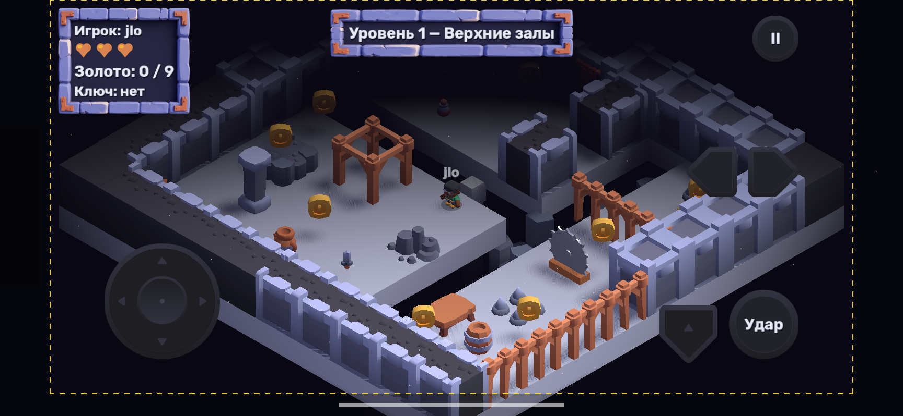
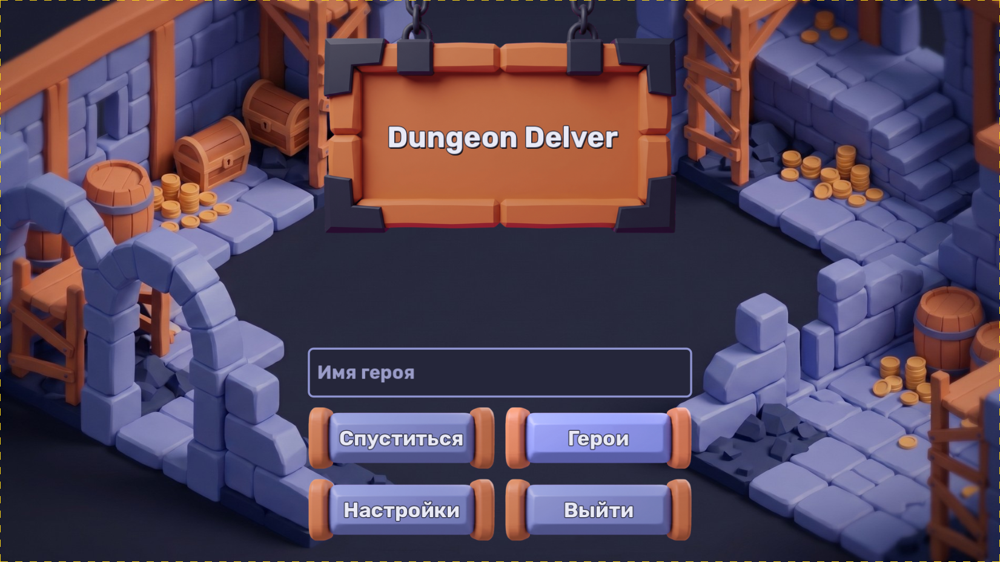
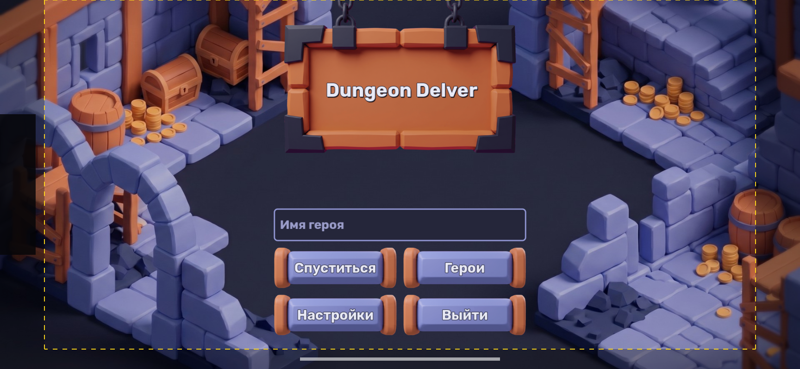
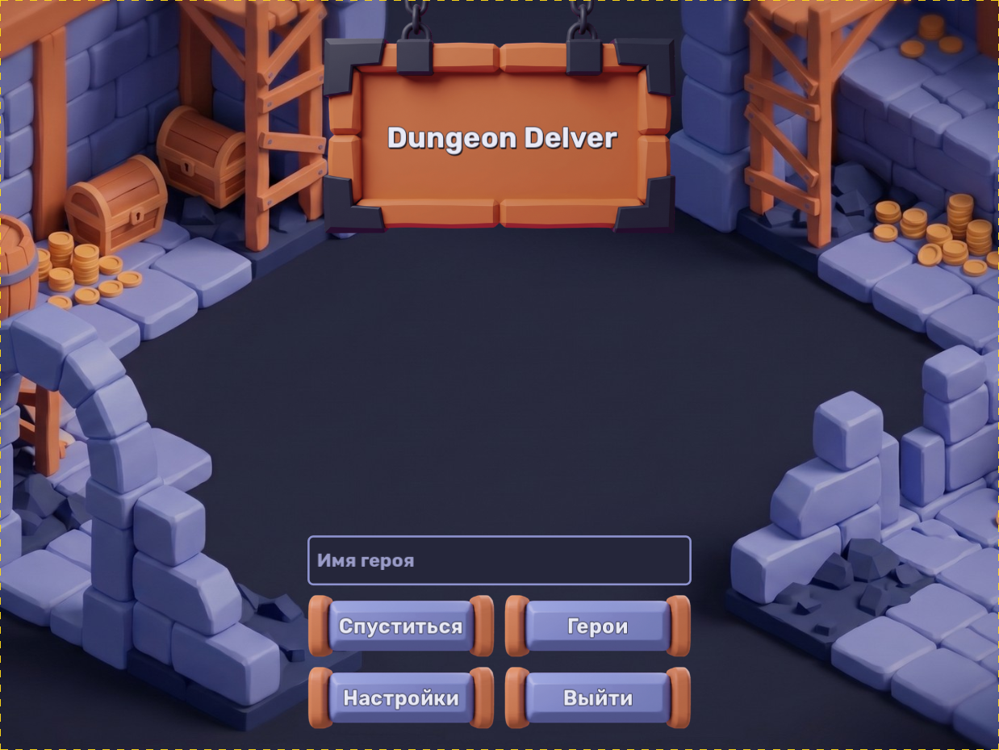
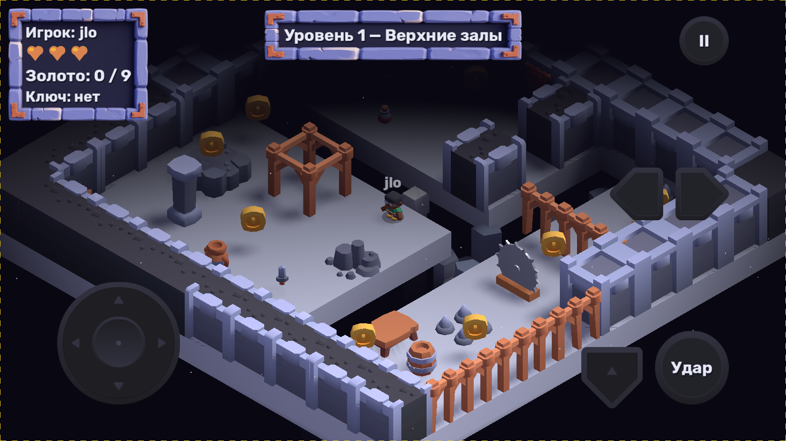
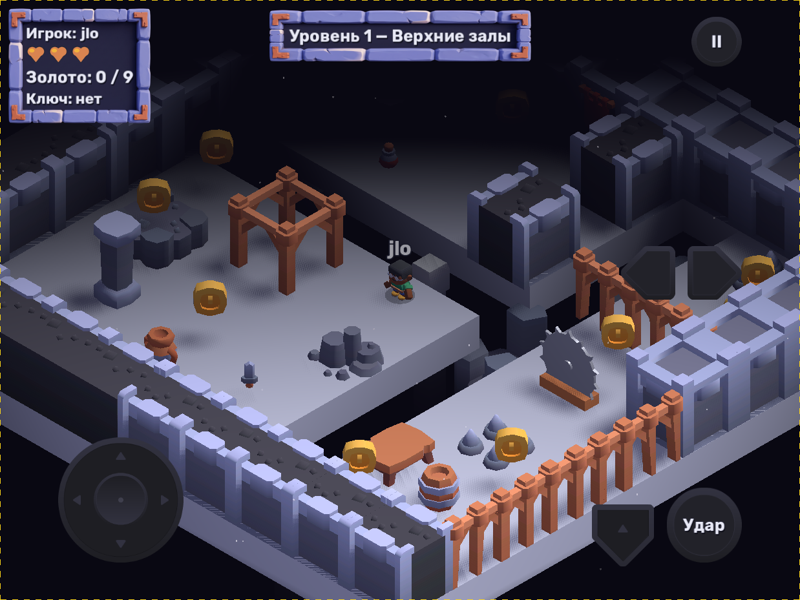
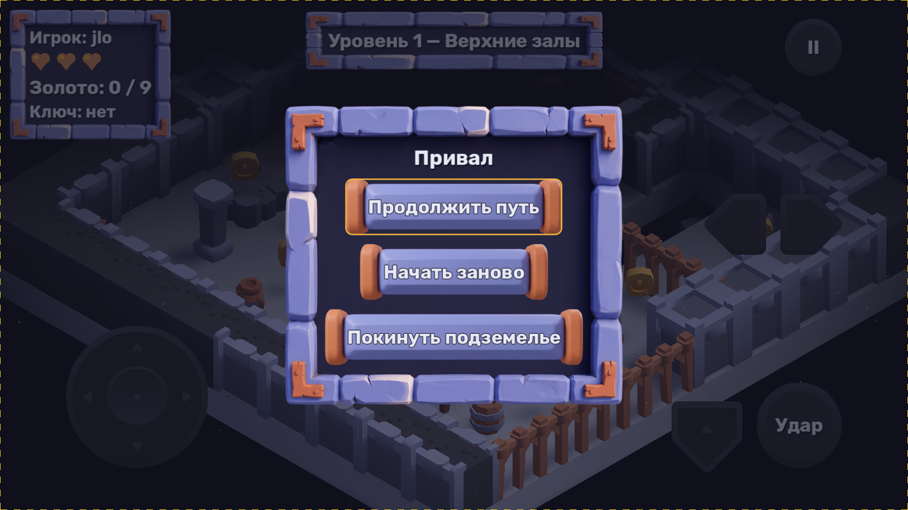
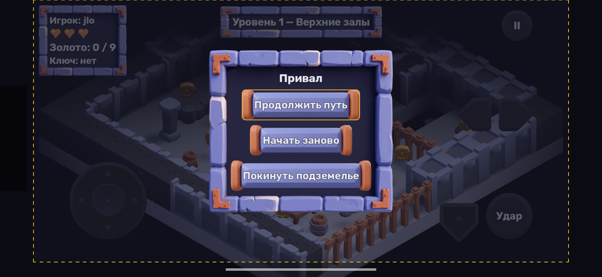
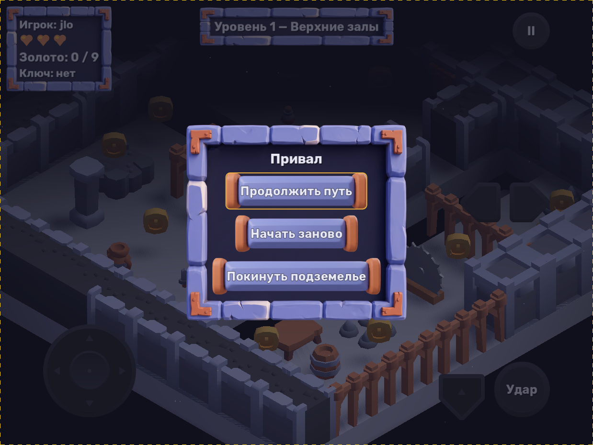

# Dungeon Delver

Изометрический 3D-платформер с элементами экшена: спуститься через два яруса подземелья,
собрать золото, найти меч и ключ, перепрыгнуть пропасти и одолеть Стража подземелья на арене.

- **Движок:** Godot 4.7.2 (GDScript со строгой типизацией)
- **Платформы:** ПК (Windows) и Android (сенсорное управление, экраны с вырезом)
- **Рендерер:** Forward+ на ПК, Mobile на телефоне



## Как запустить

1. Установить Godot 4.7.2.
2. Открыть `project.godot` в редакторе и нажать **F5** (главная сцена — `scenes/main_menu.tscn`).

Или из командной строки:

```bash
godot --path .
```

## Структура игры

Главное меню → Уровень 1 «Верхние залы» → Уровень 2 «Обвальные шахты» → Уровень 3 «Арена стража» → экран победы.
Пауза: «Продолжить путь», «Начать заново», «Покинуть подземелье»; на паузе время стоит.

## Управление

| Действие | Клавиатура / мышь | Геймпад | Сенсорный экран |
|---|---|---|---|
| Движение | W A S D, стрелки | левый стик | стик в левом нижнем углу |
| Прыжок | Пробел | A (Cross) | кнопка-стрелка справа внизу |
| Удар мечом | J, X, левая кнопка мыши | X (Square) | «Удар» в правом нижнем углу |
| Поворот камеры | Q / E | LB / RB | стрелки ◄ ► у правого края |
| Пауза | Esc, P | Start | «II» вверху справа |

## Мобильный интерфейс

Всё интерактивное и весь текст лежат внутри `SafeArea` (`scripts/ui/safe_area.gd`): контейнер берёт
безопасную область экрана (`DisplayServer.get_display_safe_area()`), переводит её из пикселей окна
в координаты UI (stretch `canvas_items` / `expand`, база 1920 × 1080) и отступает от выреза,
скруглённых углов и полоски «домой». Фоны и затемнения — на весь экран.
Текст не меньше 36 px, кнопки не меньше 120 × 120 px при базе 1920 × 1080.

### Предпросмотр устройств (только debug-сборка)

Автозагрузка `DevicePreview` (`scripts/debug/device_preview.gd`) — аналог Unity Device Simulator:
окно получает пропорции устройства (уменьшенные под монитор), а все `SafeArea` — его безопасную область.
Поверх рисуются тёмная плашка выреза, полоска «домой» и жёлтая пунктирная рамка безопасной области.

| Пресет | Разрешение | Вырез (px) |
|---|---|---|
| `phone_16_9` | 1920 × 1080 | нет |
| `notch_19_5_9` | 2532 × 1170 | слева 141, справа 141, снизу 63 |
| `tablet_4_3` | 2048 × 1536 | нет |

- **F8** — следующий пресет (выкл → phone → notch → tablet → выкл).
- **F9** — показать / скрыть рамку и вырез.
- Запуск сразу с пресетом:

```bash
godot --path . -- --device=notch_19_5_9
```

### Скриншоты

Нужен обычный запуск с окном (не `--headless`):

```bash
godot --path . -s dev/capture_screens.gd
```

Скрипт проходит по всем пресетам и сохраняет в `screenshots/` (папка в `.gitignore`)
главное меню, выбор героя, HUD, паузу, арену и экран победы. Параметры: `-- --out=<папка> --presets=notch_19_5_9,tablet_4_3`.
Итоговые скриншоты — в [`docs/screenshots/`](docs/screenshots/).

| | 16:9 | 19.5:9 с вырезом | 4:3 |
|---|---|---|---|
| Меню |  |  |  |
| HUD |  |  |  |
| Пауза |  |  |  |

## Audio sources

Every audio file in the project. Where the origin is not recorded anywhere in the repository it says
**UNKNOWN - owner to fill**; nothing here is guessed.

| File | Where used | Source | License |
|---|---|---|---|
| `assets/Audio/8-bit_sound.ogg` | menu and win screen music (MusicPlayer.MENU_TRACK) | UNKNOWN - owner to fill | UNKNOWN - owner to fill |
| `assets/Audio/levels_music.wav` | music of levels 1-2 (MusicPlayer.LEVEL_TRACK) | UNKNOWN - owner to fill | UNKNOWN - owner to fill |
| `assets/Audio/final_round_music.wav` | boss arena music (MusicPlayer.BOSS_TRACK) | UNKNOWN - owner to fill | UNKNOWN - owner to fill |
| `assets/Audio/coin.wav` | pickup: coin, key, sword (via randomizers/pickup.tres) | UNKNOWN - owner to fill | UNKNOWN - owner to fill |
| `assets/Audio/jump.wav` | hero jump (via randomizers/jump.tres) | UNKNOWN - owner to fill | UNKNOWN - owner to fill |
| `assets/Audio/hurt.wav` | hero takes damage (via randomizers/hurt.tres) | UNKNOWN - owner to fill | UNKNOWN - owner to fill |
| `assets/Audio/death.wav` | hero death (player.tscn) | UNKNOWN - owner to fill | UNKNOWN - owner to fill |
| `assets/Audio/heal.wav` | potion pickup (scenes/hazards/potion.tscn) | UNKNOWN - owner to fill | UNKNOWN - owner to fill |
| `assets/Audio/gate_open.wav` | locked gate opens (locked_gate.tscn) | UNKNOWN - owner to fill | UNKNOWN - owner to fill |
| `assets/Audio/explosion.wav` | bomb explosion, 3D (bomb.tscn) | UNKNOWN - owner to fill | UNKNOWN - owner to fill |
| `assets/Audio/sword_swing.mp3` | hero sword swing (sword.tscn) | UNKNOWN - owner to fill | UNKNOWN - owner to fill |
| `assets/Audio/sword_hits/sword_hit_1.wav, sword_hit_2.wav, sword_hit_3.wav` | sword hits an enemy (via randomizers/sword_hit.tres) | UNKNOWN - owner to fill | UNKNOWN - owner to fill |
| `assets/Audio/boss_sound/boss_roar.wav, roar_2.wav, roar_3.wav` | boss wakes up and telegraph, 3D (via randomizers/boss_roar.tres) | UNKNOWN - owner to fill | UNKNOWN - owner to fill |
| `assets/Audio/boss_sound/angry.wav` | boss enrage at half HP, 3D (boss.tscn) | UNKNOWN - owner to fill | UNKNOWN - owner to fill |
| `assets/Audio/enemy_windup.wav` | wind-up of Minion, Charger, Shooter aim, 3D (via randomizers/enemy_windup.tres) | cut from boss_sound/angry.wav (0.25-0.70 s, faded) by the AI assistant in A10 stage 2 | same as angry.wav: UNKNOWN - owner to fill |
| `assets/Audio/generated/ui_click.wav` | click on every button (scenes/systems/ui_sounds.tscn) | synthesized by tools/generate_sfx.gd in this repo (A12, placeholder) | no third-party material; project licence: UNKNOWN - owner to fill |
| `assets/Audio/generated/win.wav` | exit reached / boss defeated (level scenes, win_sound) | synthesized by tools/generate_sfx.gd in this repo (A12, placeholder) | no third-party material; project licence: UNKNOWN - owner to fill |
| `assets/Audio/generated/lose.wav` | hero died, before the restart (level scenes, lose_sound) | synthesized by tools/generate_sfx.gd in this repo (A12, placeholder) | no third-party material; project licence: UNKNOWN - owner to fill |
| `assets/Audio/generated/enemy_death.wav` | enemy death, 3D (via randomizers/enemy_death.tres) | synthesized by tools/generate_sfx.gd in this repo (A12, placeholder) | no third-party material; project licence: UNKNOWN - owner to fill |

`assets/Audio/randomizers/*.tres` are not recordings: `AudioStreamRandomizer` sets over the files above
(`random_pitch` 1.08, i.e. pitch in 0.926..1.08). All levels, the music crossfade, the 3D falloff and the
pause softening are tuned in `resources/audio_mix.tres`. Imported audio is about 3.2 MB in a build
(WAV imported as QOA); `levels_music.wav` is 1.7 MB of that.

## Ассеты и журнал ИИ

Список ассетов с источниками и лицензиями — в [`README.txt`](README.txt).
Подробный журнал работы ИИ-ассистентов — в [`docs/ai_log.md`](docs/ai_log.md).
